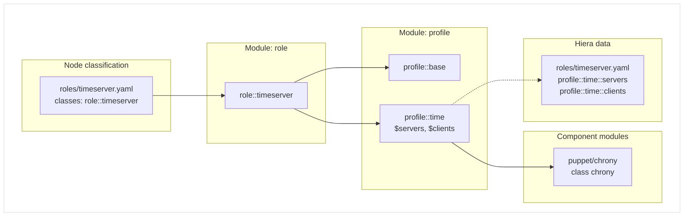

The *roles and profiles* method is the most reliable way to build reusable, configurable, and refactorable system configurations. It is an approach to
designing your infrastructure's interface, not a recipe, so expect to refine your roles and profiles over time.

## Building configurations without roles and profiles

Without roles and profiles, people typically assign component classes straight to nodes in the main manifest, in Hiera data, or in an external node
classifier (ENC), and rely on a large Hiera hierarchy to handle every variation. That can work, but most people find that it gets hard to understand and
maintain over time.

## Configuring roles and profiles

Roles and profiles are two extra layers of indirection between node classification and your component modules. Your code separates into three levels:

- Component modules: normal modules that manage one particular technology, for example `puppet/chrony`.
- Profiles: wrapper classes that use one or more component modules to configure a layered technology stack.
- Roles: wrapper classes that use multiple profiles to build a complete system configuration.

The extra layers give you a place to build a small, business-specific interface to the configuration you care about. That makes hierarchical data easier
to use, system configurations easier to read, and refactoring easier.



Solid arrows are declarations. Dashed arrows are data lookups.

Node classification assigns exactly one role to each node and does not configure it. You can assign the role with Hiera data, with an ENC, or in the main
manifest; see [Assign the role to nodes](roles_and_profiles_example.html#assign-the-role-to-nodes).

## Where roles and profiles live

Roles and profiles are ordinary classes in two modules named `role` and `profile`. Keep both in your control repository, in a `site-modules` directory
that `environment.conf` puts on the modulepath. r10k deploys the component modules in your Puppetfile to `modules`.

```text
control-repo/
├── Puppetfile          # component modules
├── environment.conf    # modulepath = site-modules:modules:$basemodulepath
├── data/               # Hiera data for the profiles
└── site-modules/
    ├── profile/
    └── role/
```

The [OpenVox control repository template](https://github.com/OpenVoxProject/control-repo-template) ships this layout. To add it to an existing repository, see [Set up your prerequisites](roles_and_profiles_example.html#set-up-your-prerequisites).

## Rules for profile classes

- Make sure you can safely `include` any profile multiple times. Don't use resource-like declarations on them.

  The one exception is a private profile: a class that you split out of a single profile only to keep it readable, and that nothing else declares. Its
  parent can use a resource-like declaration to pass values in, which keeps the data lookups in the parent. Document that the class is private.

- Profiles can `include` other profiles. Shared code in its own profile is maintained in one place, but a reader must open more files to see what a
  profile does, so split code out in units whose job is clear from the name.
- Component classes are always declared by a profile, and never assigned directly to a node. The profile owns all of their parameters: if it omits one,
  you want the default, and Hiera data must not set it on the component class. To set a parameter that the profile omits, change the profile.
- A profile doesn't automatically [contain](lang_containment.html#containing-classes) the component classes it declares. A relationship with the profile,
  such as `Class['profile::database'] -> Class['profile::app']`, reaches a component class's resources only if the profile calls `contain` on that class.
  Don't contain the same class in two profiles that are ordered against each other, because that creates a dependency cycle.
- A profile can get the information it needs in three ways. Use the most readable one that works. The
  [example profile](roles_and_profiles_example.html#write-a-profile) uses all three:

  - Hardcode a value that your business always uses. This is the easiest to read and the least flexible.
  - If you can't hardcode it, compute it from information you already have, such as facts.
  - If you can't compute it, look it up in your data. This is the most flexible and the hardest to read, because a reader must search the data to see
    what the profile does. To reduce lookups, look for parameters that you can derive from the answer to a single question.

## Rules for role classes

- A role only declares profile classes with `include`. It declares no component classes and no resources, though it can use conditional logic to choose
  profiles.

  ```puppet
  class role::timeserver {
    include profile::base
    include profile::time
  }
  ```

- A role has no class parameters and sets none on its profiles. Data lookup handles those.
- Name a role after your business's *conversational name* for the type of node. If you call a machine a "time server," `role::timeserver` fits. If you
  call it a "web server," use `role::webserver`, not `role::nginx`.

## Methods for data lookup

A profile can declare class parameters and let [automatic class parameter lookup](hiera_automatic.html) supply the values, or it can omit the parameters and call the `lookup` function:

```puppet
class profile::time {
  $servers = lookup('profile::time::servers', {
    value_type    => Array[Stdlib::Host],
    default_value => ['time1.example.com', 'time2.example.com'],
  })
  $clients = lookup('profile::time::clients', {
    value_type    => Array[String[1]],
    default_value => [],
  })
  # ...
```

Class parameters are usually preferable: they work with tools like Puppet Strings, and they're a well-known place to look for configuration. Calling
`lookup` puts the full key in the profile, where a global search finds it.
